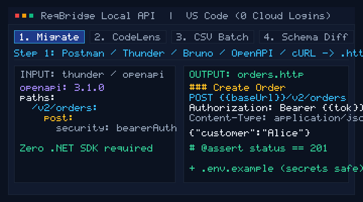

# ReqBridge Local API

[-0b1220)](https://reqbridge-local-api.pages.dev/)

**Bi-directional Postman v2.1, Thunder Client, Bruno (`.bru`), OpenAPI 3.0/3.1 (YAML/JSON) & cURL migration to Git-native `.http`, plus local CSV/JSON batch runs and Staging-vs-Prod schema-drift diff inside VS Code.**

Zero mandatory cloud logins. Zero `.NET` SDK required for OpenAPI &rarr; `.http`. Your API payloads, tokens, and CSV datasets never leave your machine.

## Coming from Thunder Client, Postman, Bruno, or OpenAPI? (3 Steps)

1. **Import in 1 Click**: Open the **ReqBridge** Activity Bar sidebar (or run `ReqBridge: Auto-Discover Local Thunder Client Collections`, `ReqBridge: Import cURL Command`, or `ReqBridge: Import & Convert Collection`).
2. **Review Git-Native `.http` + `.env.example`**: ReqBridge writes clean `.http` request blocks, extracts secret tokens into `.env.example`, and generates OpenAPI 3.1 YAML.
3. **Run & Diff Locally**: Click inline CodeLens `Send Request`, `Run CSV Batch` (JUnit XML + Markdown), or `Diff Staging vs Prod` (HTML drift report + native VS Code side-by-side JSON diff).

## Why ReqBridge?

- **Bi-Directional OpenAPI 3.0/3.1 &harr; `.http` (Zero `.NET` SDK)**: Convert OpenAPI 3.0/3.1 YAML or JSON specifications into runnable `.http` requests with synthesized payloads, or export `.http` / Postman / Thunder / Bruno collections to OpenAPI 3.1.0 YAML.
- **1-Click Thunder Client Auto-Discovery & cURL Round-Trip**: Automatically detects local `thunder-collection_*.json` files across `.vscode/thunder-client`, `~/.thunder-client`, and VS Code/Cursor globalStorage, plus instant `Import cURL` and `Copy Request as cURL`.
- **Lossless Auth & Variable Preservation**: Preserves inherited Bearer, Basic, and API-Key auth and extracts secrets into `.env.example`.
- **Local CSV & JSON Batch Runner**: Substitutes `{{variables}}` from `.env` and RFC-4180 CSV/JSON rows, executes concurrent HTTP runs, computes `p50`/`p95` latencies and assertions, and writes JUnit XML + Markdown reports.
- **Staging vs. Prod Schema-Drift Diff**: Compares HTTP status, latency delta, missing keys, added keys, and JSON type shifts before shipping—with native `vscode.diff` side-by-side view.
- **Zero-Lock-In CI Export (Pro)**: Generates a standalone `reqbridge-ci.mjs` Node runner and `.github/workflows/reqbridge-ci.yml` with zero ReqBridge runtime dependency.

## Free Core vs Pro

| Capability | Free Core ($0) | Pro ($19 Personal / $29 Team 5-Seat One-Time) |
|---|---|---|
| Postman / Thunder / Bruno / OpenAPI / cURL &harr; `.http` + OpenAPI 3.1 | Unlimited | Unlimited |
| 1-Click Thunder Client Auto-Discovery & Copy as cURL | Unlimited | Unlimited |
| Single `.http` Request Execution | Unlimited | Unlimited |
| Single-Endpoint Staging vs Prod Diff (`vscode.diff` + Report) | Unlimited | Unlimited |
| Local CSV/JSON Batch Runner | Up to 10 rows / 3 runs per UTC day | **Unlimited rows & runs** |
| Collection-Wide Staging vs Prod Schema Diff | — | **Included** |
| Zero-Lock-In CI Bundle (`reqbridge-ci.mjs` + GitHub Actions) | — | **Included** |
| Optional BYOK `pm.test()` Script Translator (OpenAI / Gemini) | — | **Included (bring your own key)** |

Visit [reqbridge-local-api.pages.dev](https://reqbridge-local-api.pages.dev/) for interactive browser tools, `.vsix` releases, and Pro licensing.

## Commands

Run from the **ReqBridge** Activity Bar view, Command Palette (`Ctrl+Shift+P` / `Cmd+Shift+P`), or `.http` CodeLens / context menus:

| Command | Description |
|---|---|
| `ReqBridge: Import & Convert Collection to .http + .env.example` | Convert Postman, Thunder Client, Bruno (`.bru` / folder), OpenAPI 3.0/3.1 (YAML/JSON), or cURL into `.http`, `.env.example`, and OpenAPI 3.1 |
| `ReqBridge: Auto-Discover Local Thunder Client Collections` | Scan local workspace, `~/.thunder-client`, and VS Code globalStorage for Thunder collections |
| `ReqBridge: Import cURL Command to .http + OpenAPI` | Paste or select any `curl ...` command and convert directly to `.http`, `.env.example`, and OpenAPI 3.1 |
| `ReqBridge: Copy Request as cURL` | Copy the active `.http` or collection request as a shell-escaped `curl` command |
| `ReqBridge: Export to OpenAPI 3.1 YAML` | Export active `.http` or collection directly to OpenAPI 3.1.0 YAML |
| `ReqBridge: Send Single Request` | Execute the current `.http` request block locally and inspect assertions |
| `ReqBridge: Run Local CSV/JSON Batch` | Run requests across CSV/JSON rows and write JUnit XML + Markdown reports |
| `ReqBridge: Diff Staging vs Prod Schema` | Compare Staging vs Production status, latency, and JSON schema drift (with `vscode.diff`) |
| `ReqBridge: Export Zero-Lock-In CI Bundle (Pro)` | Export standalone `reqbridge-ci.mjs` and `.github/workflows/reqbridge-ci.yml` |
| `ReqBridge: Manage Pro License / Activate Key` | Activate an offline `RB1.` / Creem / Gumroad license or set your BYOK API key |
| `ReqBridge: Translate pm.test() Script via BYOK (Pro)` | Translate Postman/Bruno JS tests into `# @assert` lines using your own AI key |

## Quickstart with Included Examples

Open `examples/sample.http` or right-click `examples/sample-postman.json`, `examples/sample-thunder.json`, or `examples/sample.bru` in the Explorer to test import, OpenAPI export, and `sample-data.csv` batch execution.

## Privacy & Security

- All parsing, transpilation, HTTP execution, and schema diffing run locally inside your VS Code Node.js host.
- License keys and optional BYOK AI keys are stored exclusively in VS Code `SecretStorage` (`context.secrets`), never in workspace files.
- If you do not configure a BYOK key or online Creem/Gumroad license verification, ReqBridge makes zero external network calls beyond the API endpoints you explicitly run.
